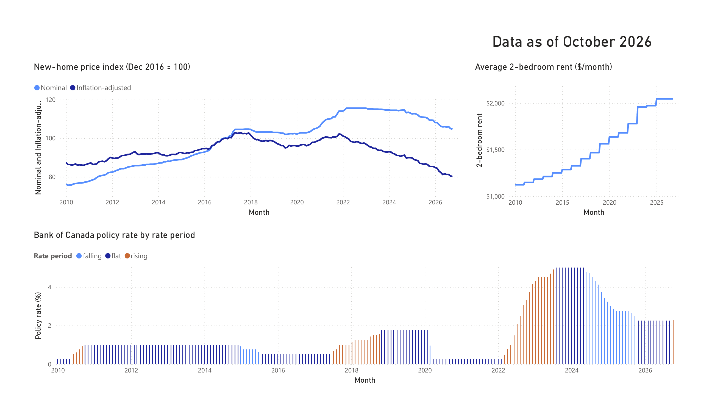
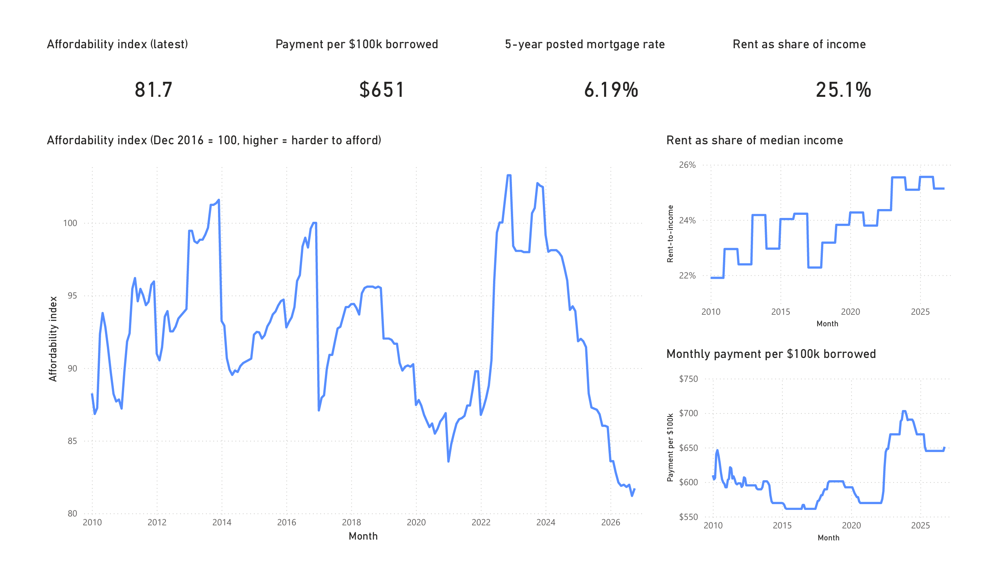
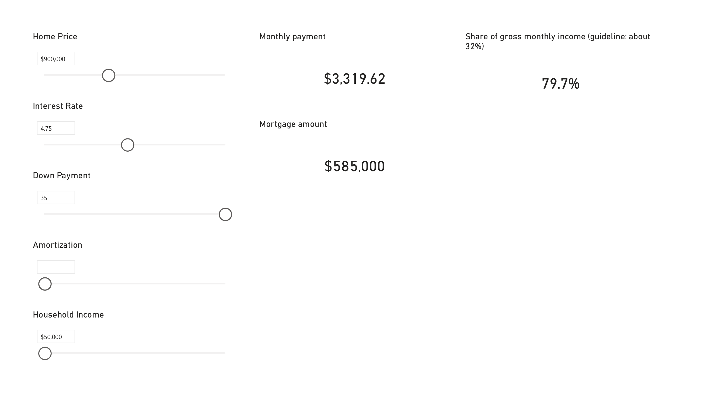

# Toronto Housing Affordability

How have interest rates changed housing affordability in the Toronto area? This project pulls public data
from Statistics Canada and the Bank of Canada, validates it, loads it into SQLite, and feeds a Power BI
dashboard.

Data as of **October 2026** (Toronto CMA, January 2010 to October 2026).

## Key findings

1. **Rate hikes raised payments by about a quarter.** The monthly payment on each $100,000 borrowed rose
   from $570 in December 2021 to a peak of $703 in October 2023 (+23%) as the 5-year posted rate went from
   4.79% to 7.04%. It is $651 today.
2. **New-home prices peaked in March 2022 and have fallen 9.4% since.** After inflation, they are 22% below
   their May 2017 peak. Combined with rising incomes, the affordability index for a new home fell from a
   peak of 103 (November 2022) to 82, close to its lowest level since 2010. *(New homes only, see limitations.)*
3. **Renting is taking a bigger share of income.** Average 2-bedroom rent rose 76% from 2010 to 2024
   ($1,123 to $1,972), while median income (families and individuals) rose 53%. Rent now takes 25% of median income,
   up from 22% in 2010.

## Dashboard

Built in Power BI from `exports/affordability.csv`. See [dashboard/README.md](dashboard/README.md).

1. **Trends:** price index (nominal and inflation-adjusted), rent and interest rates, by rate period
2. **Affordability:** affordability index and rent-to-income over time
3. **What-if calculator:** monthly payment and share of income for any price, rate, down payment and income





Full report: [dashboard/TorontoHousing.pdf](dashboard/TorontoHousing.pdf)

## How it works

`pipeline.py` runs four steps:

1. **Download** six public datasets into `data/raw/` (skipped if already downloaded; `--refresh` re-downloads).
2. **Clean and validate:** keep Toronto rows, check units, treat flagged values (`..`, `x`, `F`) as missing,
   mark estimates (`E`), check for duplicates, missing months and impossible values, convert daily and
   weekly rates to monthly averages, spread annual rent and income across months, and convert income from
   2024 dollars to each year's dollars with CPI. Every issue is logged with the action taken.
3. **Load** into SQLite (`data/housing.db`): a `monthly` table, a `data_quality` table and an
   `affordability` view that calculates the metrics in SQL.
4. **Export** `exports/affordability.csv` for Power BI and `reports/data_quality.csv`.

### Metrics

| Metric | Definition |
|---|---|
| Payment per $100k | Monthly payment on $100,000 at the 5-year rate, 25-year amortization, semi-annual compounding |
| Affordability index | Price index × payment ÷ monthly income, Dec 2016 = 100 (higher = harder to afford) |
| Real price index | Price index adjusted for inflation (CPI), Dec 2016 = 100 |
| Rent-to-income | Annual 2-bedroom rent ÷ median income (families and individuals) |
| Rate period | Rising or falling from the first to the last Bank of Canada move in the same direction; otherwise flat |

### Data quality

The Toronto series had no flagged, duplicate or missing values for 2010–2026. The pipeline found and handled:

| Issue | Action |
|---|---|
| Income data ends in 2024 | Carried forward with CPI for 2025–2026, marked as estimated |
| Rent data ends in 2025 | Carried forward for 2026, marked as estimated |
| 2026 CPI covers January to October only | 2026 income uses the average CPI to date |

Full log: [reports/data_quality.csv](reports/data_quality.csv).

### Limitations

- The price index covers **new homes only** (builders' prices for comparable homes), not resales.
- The 5-year rate is the banks' **posted** rate; most borrowers pay less. This overstates payments but not trends.
- Income for 2025–2026 and rent for 2026 are estimates.
- Payments exclude property tax, insurance, condo fees and mortgage insurance.

## Run it

```powershell
python -m venv .venv
.venv\Scripts\Activate.ps1
pip install -r requirements.txt
python pipeline.py
pytest
```

Requires Python 3.14. SQLite is built into Python, so no database setup is needed.

## Files

```
pipeline.py              download, clean, load, export
sql/schema.sql           tables
sql/views.sql            affordability calculations
tests/test_pipeline.py   payment formula, flag handling, monthly spreading, rate periods
exports/                 CSV for Power BI
reports/                 data quality log
dashboard/               Power BI file, PDF, screenshots
```

## Data sources

| Data | Source |
|---|---|
| New housing price index | Statistics Canada, table 18-10-0205-01 |
| Consumer price index | Statistics Canada, table 18-10-0004-01 |
| Average rent, 2-bedroom | Statistics Canada (CMHC), table 34-10-0133-01 |
| Median total income, families and individuals | Statistics Canada, table 11-10-0190-01 |
| Policy interest rate | Bank of Canada, series V39079 |
| 5-year conventional mortgage rate | Bank of Canada, series V80691335 |

Contains information licensed under the Statistics Canada Open Licence. Source: Bank of Canada.

